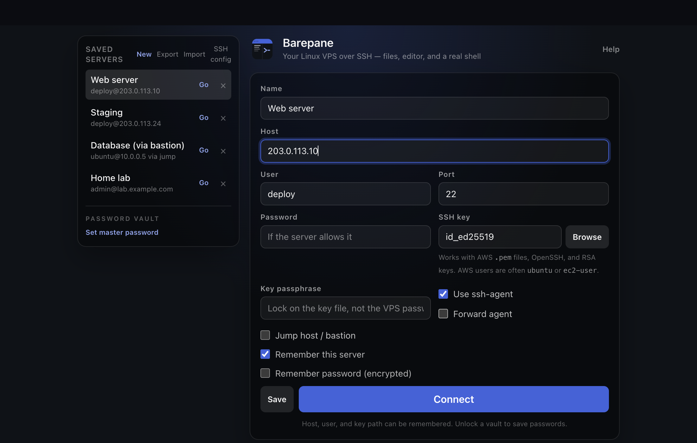

<p align="center">
  
</p>

<h1 align="center">Barepane</h1>

<p align="center">
  <strong>A desktop workstation for your Linux VPS.</strong><br>
  Files, editor, and a real terminal in one window, over plain SSH. Nothing to install on the server.
</p>

<p align="center">
  <a href="https://github.com/usmanbhatti-dev/barepane/releases/latest">Download</a> ·
  <a href="docs/testing.md">Testing guide</a> ·
  <a href="CHANGELOG.md">Changelog</a> ·
  <a href="https://github.com/usmanbhatti-dev/barepane/discussions">Discussions</a>
</p>

<p align="center">
  <a href="https://github.com/usmanbhatti-dev/barepane/actions/workflows/ci.yml"></a>
  <a href="LICENSE"></a>
  
</p>

<p align="center">
  
</p>

> Barepane is a **desktop app** for macOS, Windows, and Linux. It is not a website, and it is not remote desktop (no VNC, RDP, or GNOME needed). SSH runs inside the app.

## Why Barepane

Most cheap VPS images have no desktop. You SSH in and live in a terminal, and every config change is `nano`
over a laggy connection. Barepane gives you a local workstation window for the server:

- Browse `/etc` and `/var/www`, edit an nginx site with a real editor, and see the terminal beside it
- Upload with sudo when the folder is root-owned, with progress, chmod, and search
- Watch load, memory, disks, failed services, logs, Docker, and PM2 without installing an agent

**Agentless.** Barepane uses ordinary SSH and SFTP. Unlike remote-IDE tools it installs nothing on the server,
which matters on a 1 GB VPS or a locked-down host.

**Private by design.** No account, no telemetry, no cloud. Your hosts and credentials stay on your computer. The only
network request the app makes by itself is the update check, and you can turn it off. See [PRIVACY.md](PRIVACY.md).

## Features

**Connect**
- Password, SSH key (including AWS `.pem`), and `ssh-agent` login, with optional agent forwarding and OpenSSH certificates
- First-connect host key check (fingerprint saved on this computer; changed keys are blocked unless you replace them)
- Saved servers, import from `~/.ssh/config`, export/import between computers
- Optional master-password vault for login passwords (PBKDF2 + AES-GCM)
- Multiple servers in tabs, optional jump host / bastion

**Work**
- Tabbed editor with syntax highlighting, save, sudo retry, and a warning if the remote file changed while open
- SFTP browser: upload / download with progress, chmod, bookmarks, name search, and search inside files
- Real terminal: multiple shells per server, split view, find in scrollback, run-on-all, saved command snippets
- Command palette (⌘/Ctrl K) and in-app help (F1)

**Operate**
- Local, remote, and SOCKS port forwarding (localhost only)
- Live logs: follow journalctl, a file, or a Docker container
- Systemd and Docker panel: start / stop / restart, jump to logs
- VPS health: load, memory, disks, failed services, top processes
- Apps snapshot: listening ports, process stacks, nginx sites, PM2 and Compose, security glance (sshd, firewall, certificates)
- Site actions: test nginx, reload nginx or PHP-FPM

## Install

Download the latest installer from the [Releases page](https://github.com/usmanbhatti-dev/barepane/releases/latest):

| OS | File |
|---|---|
| macOS (Apple Silicon) | `Barepane-<version>-mac-arm64.dmg` |
| macOS (Intel) | `Barepane-<version>-mac-x64.dmg` |
| Windows 10/11 (64-bit) | `Barepane-<version>-win-x64.exe` |
| Linux (x64 or arm64) | `Barepane-<version>-linux-<arch>.AppImage` |

Verify a download against `SHA256SUMS.txt` on the release page.

**Early builds may be unsigned.** Until signing is set up for a release, your OS may warn you:

- **macOS:** right-click the app → **Open** the first time (or `xattr -dr com.apple.quarantine /Applications/Barepane.app`)
- **Windows:** SmartScreen → **More info** → **Run anyway**
- **Linux:** `chmod +x Barepane-*.AppImage && ./Barepane-*.AppImage`

Updates: Barepane tells you when a new version is out. Nothing downloads or restarts until you click. You can also
check by hand in **Help (F1) → About**.

## Status and compatibility

Barepane is developed and tested on **Ubuntu servers** and used from **macOS**. Debian and other systemd-based Linux
distributions should work the same way; the Windows and Linux desktop builds are newer and have had less hands-on
testing. If something is off on your setup, please [open an issue](https://github.com/usmanbhatti-dev/barepane/issues/new/choose),
it is genuinely useful.

## Develop

Requires Node.js 22+.

```bash
npm install
npm run dev
```

Use the **Electron window**. Do not open the Vite URL in a browser; SSH is not available there.

```bash
npm test             # unit tests for the shared logic
npm run typecheck
npm run pack:mac     # .dmg + .zip in release/ (also pack:win, pack:linux)
```

End-to-end manual checks: [docs/testing.md](docs/testing.md). How releases are cut: [docs/releasing.md](docs/releasing.md).

## Security

- Passwords and sudo prompts stay in memory for the session unless you unlock a master-password vault
- Host, user, port, and key *path* may be remembered without a vault
- Saved SSH passwords are encrypted (PBKDF2 + AES-GCM) on this computer; they cannot be recovered if the master password is lost
- File writes to system folders use `sudo` only after you confirm
- The renderer is sandboxed, with no Node access; IPC is accepted only from the app window

Found a vulnerability? Please follow [SECURITY.md](SECURITY.md) and do not open a public issue.

## Contributing

Bug reports, testing on other distros, docs, and code are all welcome. See [CONTRIBUTING.md](CONTRIBUTING.md) and the
[Code of Conduct](CODE_OF_CONDUCT.md).

## License

[MIT](LICENSE). Free to use, modify, and share.

Ubuntu is a registered trademark of Canonical Ltd. Barepane is an independent project and is not affiliated with or
endorsed by Canonical.
